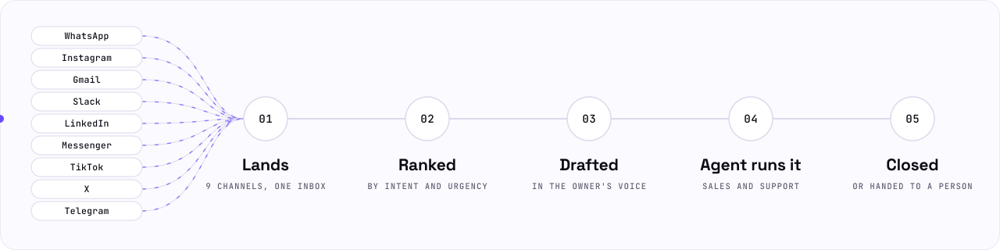
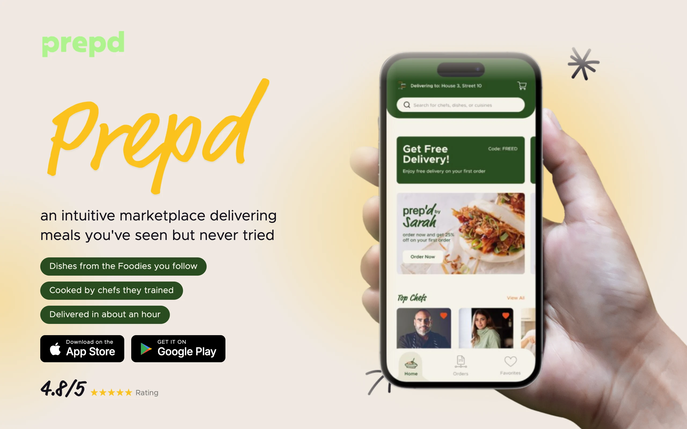
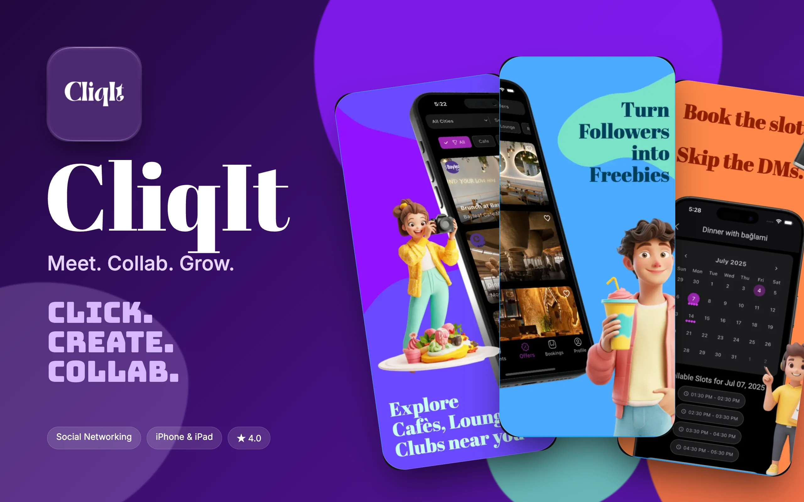
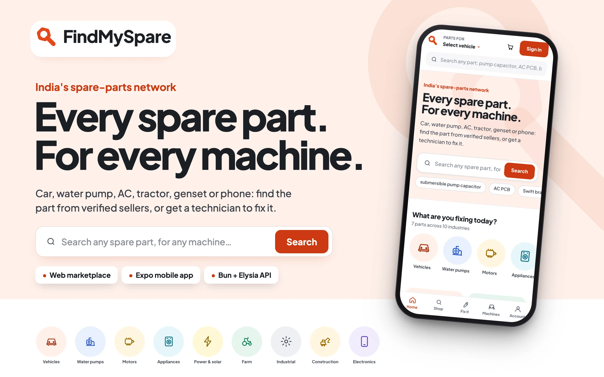
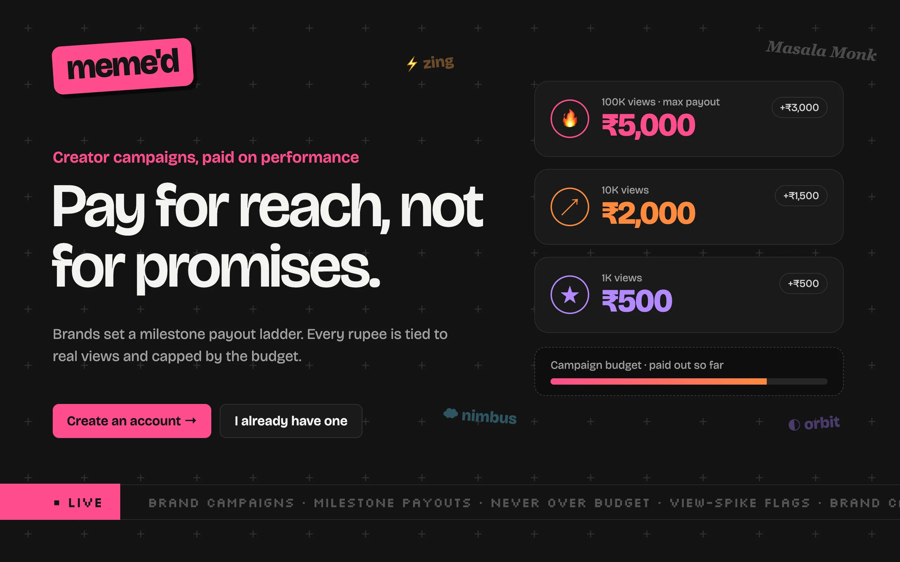
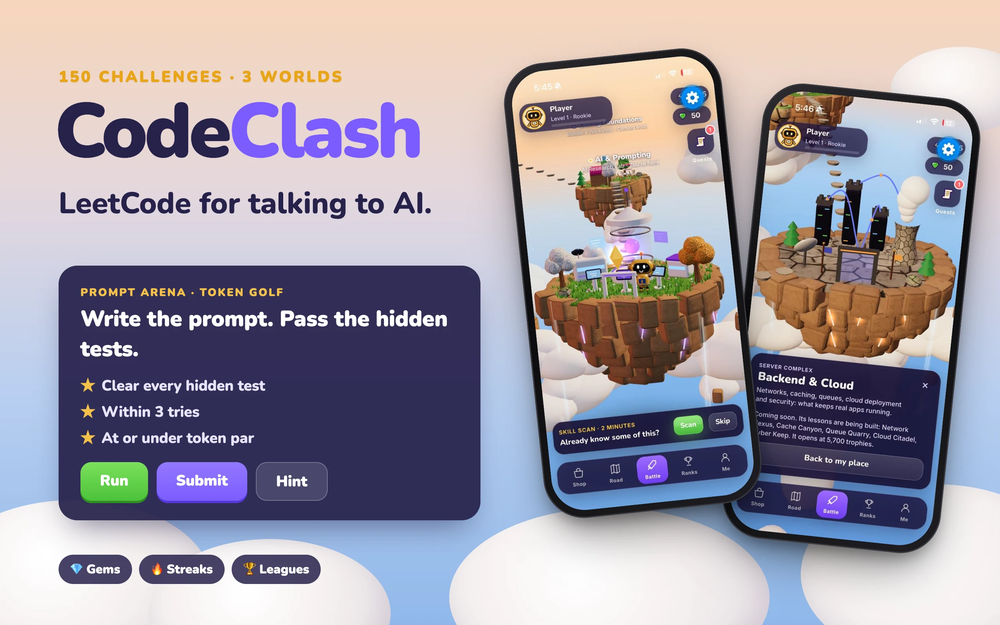

<a href="https://danyalsameer.vercel.app">
  <picture>
    <source media="(prefers-color-scheme: dark)" srcset="assets/hero-dark.svg">
    
  </picture>
</a>

  <a href="https://danyalsameer.vercel.app"><b>Portfolio</b></a>
  &nbsp;·&nbsp;
  <a href="https://danyalsameer.vercel.app/work/mira/"><b>Mira</b></a>
  &nbsp;·&nbsp;
  <a href="https://thedslabs.vercel.app"><b>DS Labs</b></a>
  &nbsp;·&nbsp;
  <a href="#selected-work"><b>Work</b></a>
  &nbsp;·&nbsp;
  <a href="#toolbox"><b>Toolbox</b></a>

I build products end to end, from the database to the App Store. Right now that is **Mira**, an AI operator that answers a business's DMs in the owner's own voice. Before that: a food-creator marketplace, an App Store app for creator collabs, a payouts engine that can't overspend, and a spare-parts network for India.

 

## Now shipping: Mira

**An AI operator for every inbox.** Customers message a business on Instagram, WhatsApp, Gmail and six more channels. Mira reads each message, works out what the customer is trying to get done, and replies in the owner's voice, or hands the thread to a person when it should.

<picture>
  <source media="(prefers-color-scheme: dark)" srcset="assets/mira-dark.svg">
  
</picture>

<table>
  <tr>
    <td width="50%" valign="top">
      <b>Reads the conversation, not keywords</b> 
      Every message is read as an act (asks, objects, hesitates, chases…) against up to two open jobs, such as <i>buy</i>, <i>book</i> or <i>track</i>. Each job moves from <i>exploring</i> to <i>closed</i>, and the reply is picked from where the job stands.
    </td>
    <td width="50%" valign="top">
      <b>Grounded in what the owner said</b> 
      Replies come from the owner's own facts, retrieved with multilingual embeddings. When Mira doesn't know something, she asks the owner instead of making it up.
    </td>
  </tr>
  <tr>
    <td width="50%" valign="top">
      <b>Built on the edge</b> 
      A Hono API on Cloudflare Workers, with Queues for jobs, Durable Objects for the live inbox, and Postgres behind Hyperdrive with Drizzle. The brain runs on the Claude Agent SDK.
    </td>
    <td width="50%" valign="top">
      <b>Tested before it talks to a customer</b> 
      150+ test files, plus a corpus of 60 conversations across different kinds of business that is replayed and scored turn by turn before each rollout.
    </td>
  </tr>
</table>

  430+ of my commits in 2026 · 1,000+ in the repo · live in production 
  <a href="https://danyalsameer.vercel.app/work/mira/">Case study</a> &nbsp;·&nbsp; <a href="https://prototype.miraadmin7.workers.dev/">Try the prototype</a>

 

## Selected work

<table>
  <tr>
    <td width="50%" valign="top">
      
      <h3>Prepd 2025 · iOS, Android & web</h3>
      <b>Order the dishes you see food creators make.</b> Meals are cooked in cloud kitchens by chefs the creator trained, delivered in about an hour. Creators get an app and dashboard to manage recipes and track sales.
      
<code>Next.js</code> <code>iOS</code> <code>Android</code>

      <a href="https://www.prepdby.com/">Live ↗</a> &nbsp;·&nbsp; <a href="https://danyalsameer.vercel.app/work/prepd/">Case study ↗</a>
    </td>
    <td width="50%" valign="top">
      
      <h3>CliqIt 2025 · iPhone & iPad</h3>
      <b>Meet. Collab. Grow.</b> An App Store app that connects creators with local brand offers: browse, RSVP to a slot, get real-time alerts and check in on site with a QR code.
      
<code>iOS</code> <code>iPadOS</code> <code>Push</code> <code>QR check-in</code>

      <a href="https://apps.apple.com/in/app/cliqit/id6748177182">App Store ↗</a> &nbsp;·&nbsp; <a href="https://danyalsameer.vercel.app/work/cliqit/">Case study ↗</a>
    </td>
  </tr>
  <tr>
    <td width="50%" valign="top">
      
      <h3>FindMySpare 2026 · web, mobile & API</h3>
      <b>Every spare part, for every machine in India.</b> Three surfaces on one backend: buy from verified sellers or request quotes, book a technician, and keep a passport of every machine's repairs.
      
<code>Next.js</code> <code>Expo</code> <code>Bun</code> <code>Elysia</code> <code>Drizzle</code> <code>Postgres</code> <code>Socket.IO</code>

      <a href="https://findmyspare.vercel.app">Live ↗</a> &nbsp;·&nbsp; <a href="https://github.com/Danyalsk/findmyspare">Code ↗</a> &nbsp;·&nbsp; <a href="https://danyalsameer.vercel.app/work/findmyspare/">Case study ↗</a>
    </td>
    <td width="50%" valign="top">
      
      <h3>Meme'd 2026 · web app + API</h3>
      <b>Creator campaigns with payouts that never overspend.</b> Creators are paid as their posts cross view milestones. MongoDB transactions guarantee a campaign never pays past its budget, even under concurrent updates.
      
<code>Next.js</code> <code>Express</code> <code>MongoDB</code> <code>Redis</code> <code>Jest</code> <code>Docker</code>

      <a href="https://getmemed.vercel.app">Live ↗</a> &nbsp;·&nbsp; <a href="https://github.com/Danyalsk/getmemed">Code ↗</a> &nbsp;·&nbsp; <a href="https://danyalsameer.vercel.app/work/memed/">Case study ↗</a>
    </td>
  </tr>
  <tr>
    <td width="50%" valign="top">
      
      <h3>CodeClash 2026 · iOS & Android prototype</h3>
      <b>LeetCode for talking to AI.</b> 150 prompt-writing challenges across three worlds, graded on the phone against hidden tests and a token par, with streaks, leagues and a mascot that reviews your prompt.
      
<code>React Native</code> <code>Expo</code> <code>TypeScript</code>

      <a href="https://danyalsameer.vercel.app/work/codeclash/">Case study ↗</a>
    </td>
    <td width="50%" valign="top">
      <h3>More from the lab</h3>
      

        <a href="https://github.com/Danyalsk/content-dna-mvp"><b>ContentDNA</b></a> 
        A YouTube video in, shorts and posts out: Whisper transcription, a local LLM, and OpenCV face-tracked 9:16 crops with FFmpeg.
      

      

        <a href="https://github.com/Danyalsk/snookit"><b>Snook.it</b></a> 
        An Expo app for snooker and pool halls: tables, live sessions, waitlists and bookings.
      

      

        <a href="https://mueenfilmsandco.vercel.app"><b>Mueen Films & Co.</b></a> 
        Website and brand identity for a Konkan photography and film studio.
      

      

        <a href="https://thedslabs.vercel.app"><b>DS Labs</b></a> 
        The parent studio behind the work, with an image-led site built in React and Vite.
      

      <a href="https://github.com/Danyalsk?tab=repositories">All repositories ↗</a>
    </td>
  </tr>
</table>

 

## Toolbox

<picture>
  <source media="(prefers-color-scheme: dark)" srcset="assets/toolbox-dark.svg">
  
</picture>
